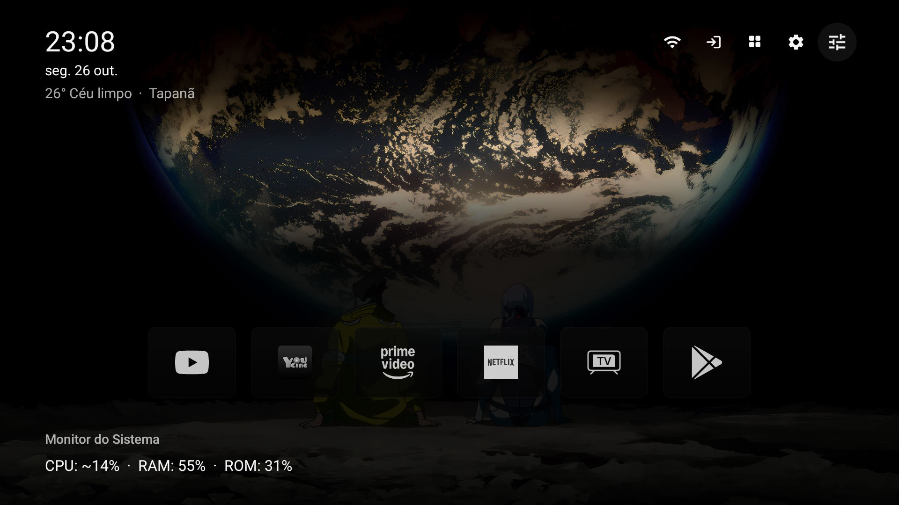
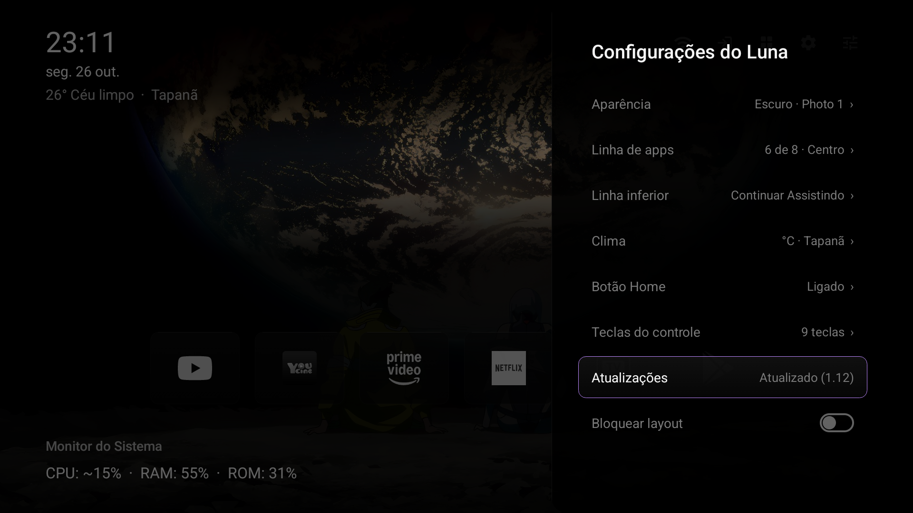

# Luna Launcher

Um launcher de TV minimalista, leve e focado em desempenho.



## Funcionalidades
- **Minimalista:** Sem anúncios ou distrações desnecessárias.
- **Rápido:** Otimizado para hardware de TV, usando cache de bitmaps e threads eficientes.
- **Personalizável:** Altere o estilo dos ícones, papéis de parede (incluindo imagens Bing e pastas locais) e cor de destaque.
- **Monitor do Sistema:** Visualize uso de CPU, Memória e ROM na tela inicial.
- **Controle:** Gerencie seus canais de aplicativos e "Continuar assistindo" com facilidade.



## Como instalar
1. Baixe o APK mais recente das [Releases](https://github.com/hwoxan/Luna_Launcher/releases).
2. Instale via adb:
   ```bash
   adb install -r app-release.apk
   ```
3. Conceda permissão especial (necessária para reativar o serviço Home após reinicializações):
   ```bash
   adb shell pm grant dev.luna android.permission.WRITE_SECURE_SETTINGS
   ```

## Papéis de Parede Personalizados
Você pode copiar arquivos `.jpg`, `.png` ou `.webp` para a pasta do aplicativo na TV:
```bash
adb push meu-papel-de-parede.jpg /sdcard/Android/data/dev.luna/files/wallpapers/
```
EOF
